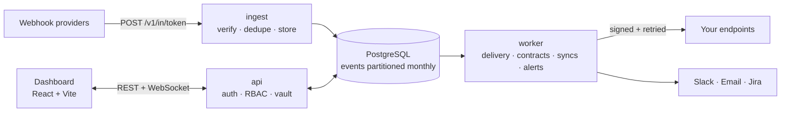

<div align="center">

# ⚡ Relaya

**Integration reliability & control platform.**
Receive every webhook, deliver it reliably, and see and fix what breaks before your customers do.

[](backend/go.mod)
[](backend/docker-compose.yml)
[](web/)
[](web/)
[](backend/README.md#operations)
[](https://github.com/dhirajray-12/relaya-sdks)

[Features](#-features) · [Architecture](#-architecture) · [Quick start](#-quick-start) · [Docs](#-documentation) · [SDKs](https://github.com/dhirajray-12/relaya-sdks)

</div>

---

## 🧭 Why Relaya

Third-party webhooks fail quietly. A provider changes a payload, your endpoint returns a 500 at 3 a.m., a retry storm creates duplicate orders, and nobody notices until a customer does.

Relaya sits between the providers and your application:

```
Stripe · Razorpay · Shopify · GitHub · …  ──▶  Relaya  ──▶  your endpoints
                                              │
                         verify · dedupe · store · deliver · retry
                         detect drift · alert · repair · replay
```

It acknowledges every event only after storing it, then takes responsibility for getting it to you, with a full audit trail of everything that happened along the way.

---

## ✨ Features

| | Feature | What it does |
|---|---|---|
| 🛡️ | **Webhook gateway** | Verifies provider signatures, removes duplicates and stores every event before returning `200`. |
| 🔎 | **Event Explorer** | Search, inspect and replay any event from the dashboard or the API. |
| 🚚 | **Reliable delivery** | Forwards events to your destinations with retries, idempotency keys, HMAC signatures and SSRF protection. |
| 📐 | **Integration contracts** | Learns each provider's payload shape and raises an incident when it drifts. |
| 🔧 | **Repair rules** | Fixes payloads at send time, so retries and replays get the fix too. |
| 🔁 | **Replay & recovery** | Re-delivers everything affected by an incident and verifies the result. |
| 🔔 | **Alerts** | Email, Slack, Jira and outbound webhooks. |
| 🔌 | **Connections** | OAuth connections for your users (Zoho, HubSpot, Google, Shiprocket…) with token refresh, an API proxy and syncs. |
| 📤 | **Outbound webhooks** | Send signed webhooks to your own customers, with a hosted portal for their endpoints. |
| 🏛️ | **Platform** | Auth and RBAC, an envelope-encrypted credential vault, an audit log and realtime updates over WebSocket. |

**Supported providers:** Stripe, Razorpay, Cashfree, PayU, PhonePe, Shopify, GitHub, Standard Webhooks (Svix) and a generic HMAC provider.

---

## 🧱 Architecture



| Service | Role |
|---|---|
| `cmd/ingest` | Small, separate receiver on `:8081`. Keeps accepting webhooks even if the API is down. |
| `cmd/api` | REST API and realtime WebSocket on `:8080`. |
| `cmd/worker` | Delivery, retries, contract checks, repair, syncs, alerts and status probes. Uses `SKIP LOCKED` and `LISTEN/NOTIFY`. |
| `cmd/migrate` | Database migrations. |

**Design highlights:** monthly event partitions with cross-partition dedup, raw payloads kept byte-exact for replay (masked only when read), credential headers dropped at ingest, and logs that never contain headers or bodies.

---

## 🚀 Quick start

**Prerequisites:** Go 1.27+, Node.js 20+, and Docker (or a local PostgreSQL 17).

```sh
# 1. Clone with the SDK submodule
git clone --recurse-submodules https://github.com/dhirajray-12/relaya.git
cd relaya

# 2. Start the backend (dev only)
cd backend
cp .env.example .env            # then set MASTER_KEY: openssl rand -base64 32
docker compose up --build

# 3. Start the dashboard (in a new terminal)
cd web
npm install
API_PROXY_TARGET=http://localhost:8080 npm run dev   # → http://localhost:5173
```

Create a webhook in the dashboard, point a provider at its ingest URL, and watch events arrive live in the Explorer.

---

## 🧪 Tests

```sh
cd backend && go test ./...              # unit + end-to-end (set TEST_DATABASE_URL)
cd web && npm run lint && npm run build  # dashboard
```

---

## 📂 Repository layout

| Path | Contents |
|---|---|
| [`backend/`](backend/README.md) | Go services (`ingest`, `api`, `worker`, `migrate`) and `internal/` packages |
| [`web/`](web/README.md) | Dashboard: React, TypeScript, Vite, Tailwind CSS and shadcn/ui |
| `sdk/` | Client SDKs, as a git submodule ([relaya-sdks](https://github.com/dhirajray-12/relaya-sdks)) |
| `.github/workflows/` | CI for the backend and dashboard, plus the production release pipeline |

---

## 📚 Documentation

- **[Backend](backend/README.md)**: services, API reference, providers, delivery, contracts, repair rules, alerts, connections and operations
- **[Dashboard](web/README.md)**: development, build and deployment
- **[Deployment & CI/CD](DEPLOYMENT.md)**: how a push to `main` is tested, built and released
- **[Local build](LOCAL_BUILD.md)** · **[VPS setup (Linux)](VPS_SETUP.md)** · **[VPS setup (Windows + IIS)](VPS_SETUP_WINDOWS.md)**

### CI/CD at a glance

1. **Branches and pull requests:** backend and dashboard tests run on every push.
2. **`main`:** the tests run again, then the Windows binaries and the dashboard are built and published as the `production` release.
3. **Server:** a scheduled task picks up the release, verifies its SHA-256, deploys it, checks `/api/healthz` and rolls back automatically if anything fails.

---

## 🧩 Related

- **[relaya-sdks](https://github.com/dhirajray-12/relaya-sdks)**: official SDKs for Node.js, Python, PHP, Go and Java, plus the `relaya` CLI

---

<div align="center">

Designed and built by **[Dhiraj Ray](https://github.com/dhirajray-12)**

</div>
